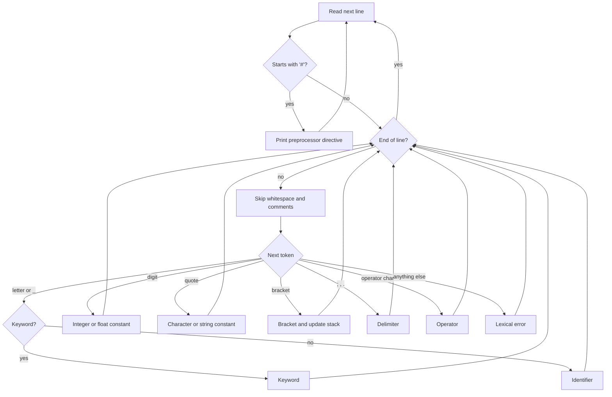

# Lexical Analyzer in C

A command-line lexical analyzer (scanner) for C source code. It reads a `.c` file, splits it into tokens one by one, classifies each token, and reports lexical and simple syntax errors, which is the stage that follows preprocessing in the compilation pipeline.

```
./lexer program.c
```

---

## Table of contents

- [Features](#features)
- [Project structure](#project-structure)
- [Build and run](#build-and-run)
- [Example](#example)
- [Token classification](#token-classification)
- [Error detection](#error-detection)
- [How it works](#how-it-works)
- [Customizing](#customizing)
- [Limitations](#limitations)
- [Exit codes](#exit-codes)

---

## Features

- Classifies every token in a C source file, with its line number.
- Recognizes preprocessor directives, reserved and non-reserved keywords, identifiers, integer, float and hex constants, character and string constants, operators, delimiters and brackets.
- Sub-classifies operators as arithmetic, relational, assignment, logical or bitwise.
- Skips `//` and `/* ... */` comments, including comments that span several lines.
- Detects errors: missing `;`, unbalanced or mismatched brackets, unterminated strings, characters and comments, invalid characters and malformed numbers.
- Prints a summary with a count per token type and the total number of errors.
- Does not use `strtok()`. The scanner walks each line by index, so the input line is never modified.
- Single file, standard C, no dependencies beyond the C library.

## Project structure

```
.
├── lexical_analyzer.c   # the analyzer (all source code)
├── test_ok.c            # valid sample program, produces no errors
├── test_err.c           # sample with deliberate errors
└── README.md
```

## Build and run

**Requirements:** any C compiler (`gcc` or `clang`).

```bash
# build
gcc -Wall -Wextra -o lexer lexical_analyzer.c

# run on a file
./lexer test_ok.c
./lexer test_err.c
```

Running without an argument prints a usage message:

```
Usage: ./lexer <file.c>
```

## Example

**Input** (`test_ok.c`)

```c
#include <stdio.h>
/* simple program */
int main()
{
    int sum;
    sum = 3 + 2;
    return 0;
}
```

**Output** (excerpt)

```
LINE   TOKEN TYPE                 LEXEME
------------------------------------------------------------
1      Preprocessor directive     #include <stdio.h>
3      Reserved keyword           int
3      Identifier                 main
3      Open parenthesis           (
3      Close parenthesis          )
4      Open brace                 {
5      Reserved keyword           int
5      Identifier                 sum
5      Delimiter (end of statement) ;
...
```

**Output with errors** (`test_err.c`, excerpt)

```
4      ERROR                      missing ';' after 'sum'
7      ERROR                      invalid numeric constant / identifier '9abc'
9      ERROR                      unterminated string constant "oops;
10     ERROR                      invalid character '@'
6      ERROR                      '(' opened here is never closed
3      ERROR                      '{' opened here is never closed
```

**Summary** printed at the end of every run:

```
==================== SUMMARY ====================
Preprocessor directive     1
Reserved keyword           6
Non-reserved keyword       0
Identifier                 10
...
TOTAL TOKENS               48
ERRORS                     0

Result: no errors found.
```

## Token classification

| Token type | Examples | How it is detected |
|---|---|---|
| Preprocessor directive | `#include <stdio.h>` | The first non-space character of the line is `#`. The whole line is printed as one token. |
| Reserved keyword | `int`, `return`, `while` | Matches the reserved keyword table. |
| Non-reserved keyword | `NULL`, `EOF`, `size_t` | Matches the non-reserved table. |
| Identifier | `sum`, `main`, `printf` | Starts with a letter or `_` and is not in either keyword table. |
| Integer constant | `42`, `0x1F`, `10UL` | Digits, or `0x` followed by hex digits, with optional `u`, `U`, `l` and `L` suffixes. |
| Float constant | `3.14`, `.5`, `2e-3`, `1.5f` | Contains a decimal point and/or an exponent. |
| Character constant | `'a'`, `'\n'` | Starts with `'`. |
| String constant | `"hello\n"` | Starts with `"`. |
| Operator | `+ - * / % ++ -- == != < > <= >= = += && \|\| ! & \| ^ ~ << >> ->` | Longest match first, so `<=` is never read as `<` followed by `=`. |
| Delimiter / special character | `;` `,` `.` | Single characters, with `;` reported as the end of a statement. |
| Bracket | `( ) { } [ ]` | Pushed on, and popped from, a bracket stack. |

## Error detection

| Error | Example | Message |
|---|---|---|
| Missing semicolon | `int sum` then a new statement on the next line | `missing ';' after 'sum'` |
| Unclosed bracket | `if (x > 1 {` | `'(' opened here is never closed` |
| Unexpected closing bracket | a stray `}` | `unexpected '}' - no matching opening bracket` |
| Mismatched brackets | `( ... ]` | `mismatched ']' (open '(' from line N)` |
| Unterminated string | `"oops;` | `unterminated string constant "oops;` |
| Unterminated character | `'a` | `unterminated character constant 'a` |
| Unterminated comment | `/* never closed` | `unterminated comment` |
| Invalid character | `@`, `` ` ``, `$` | `invalid character '@'` |
| Malformed number | `9abc` | `invalid numeric constant / identifier '9abc'` |

## How it works

The scanner follows the classic flowchart: read a line, then scan one token at a time until the end of the string.



Key design points:

- **No `strtok()`.** It overwrites delimiters with `\0` and destroys the data, so each line is scanned by index instead.
- **Bracket stack.** Every opening bracket is pushed with its line number. A closing bracket must match the top of the stack. Anything left on the stack at end of file is reported as never closed.
- **Missing-semicolon check.** When a line ends with something that normally ends a statement (an identifier, a constant, `return`, `break` or `continue`), the analyzer looks at the next token. If that token does not continue the statement, the error is reported against the earlier line.
- **State across lines.** Only the "inside a block comment" flag and the bracket stack carry over from one line to the next.

## Customizing

All language tables are arrays at the top of `lexical_analyzer.c`:

| To change | Edit |
|---|---|
| Reserved keywords | `reserved_keywords[]` |
| Non-reserved keywords | `non_reserved_keywords[]` |
| Multi-character operators | `multi_ops[]` (keep longest first) |
| Single-character operators | `single_ops` |

To add a new token category, add an entry to the `enum` and to `cat_names[]`, then emit it with `emit(...)` in the scanner loop.

## Limitations

This is a scanner, not a full parser, so some errors are out of scope:

- The missing-semicolon check is based on line endings. It will not catch a missing `;` after a closing `)` (for example `foo(1)` on its own line), and it ignores lines inside parentheses.
- Multi-line preprocessor directives (lines ending in `\`) are not joined.
- Macro expansion, `#include` resolution and `#if` evaluation are not performed.
- Trigraphs and digraphs are not recognized.
- Lines longer than 4095 characters are split.
- `*` and `&` are always reported as operators, so pointer declarations such as `char *s` show `*` as an arithmetic operator. Telling the cases apart needs a parser.

## Exit codes

| Code | Meaning |
|---|---|
| `0` | Analysis finished with no errors |
| `1` | Missing argument or the input file could not be opened |
| `2` | Analysis finished and one or more errors were reported |
